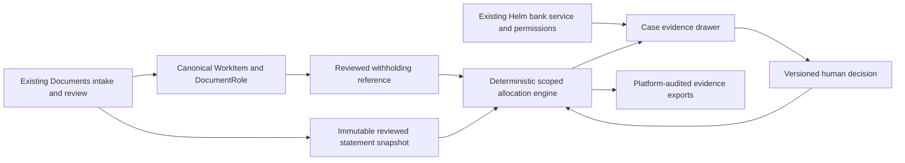

# TRINETRA architecture

Baseline: `bf8f57f691aec7122d9ebaf4a4e13ae9d22ae19c`. Work stays on
`hardening/trinetra`. The original preliminary audit is historical; this document
describes the current implementation and does not imply release approval.

## Data flow

No new OCR, blob store, financial ledger, tax portal, bank importer, email sender,
payment processor or generic discussion system is introduced. `ledger_store`
provides canonical invoice facts; Helm's identity normalization identifies the
receiving business. Bank evidence passes Helm's existing book and line access
checks. Document links open the existing evidence/review surface. GST contributes
spreadsheet escaping/formatting patterns only, never TDS amounts or eligibility.

## Four tables

`trinetra_profiles`: encrypted PAN and random per-profile identity salt; masked
PAN and keyed identifiers. JWT rotation does not change entity identity.

`trinetra_statements`: canonical source document/version, explicit entity/year,
normalized keyed rows, fingerprint, parser version, revision and active selection.
Content is immutable through the API. A partial unique index admits one active
snapshot per profile/year. Identical reimports return the original snapshot,
including its `active` flag; they do not silently reactivate old evidence.

`trinetra_credits`: canonical invoice reference, reviewed expected amount, source
version fingerprint and review metadata. It does not copy invoice/bank ledger
transactions. Invoice fingerprints cover both WorkItem and DocumentRole versions.

`trinetra_decisions`: append-only API revisions with actor, reason and allocations.
Only the current decision's allocations affect current figures, and only for the
selected unchanged snapshot. Database administrators remain trusted; no separate
cryptographic certificate or database immutability claim is made.

Every table has organization/workspace scope. Composite foreign keys prevent
profiles, documents and cases being linked across workspaces. Amounts use integer
micros internally and exact decimal strings over JSON. Inputs accept nonnegative
decimal INR with at most two places. Signed corrections require explicit review,
not silent netting. The versioned policy is `trinetra-v1-paise-exact`.

## Transactions and computation

Profile row locks serialize allocation/import/reconfirmation decisions. Each
review carries an expected case revision; stale submissions return 409. Shared
posting and expectation amounts cannot be overallocated. Organization locks
serialize capacity checks across workspaces. Snapshots are deactivated and flushed
before the new active row is inserted. Source erasure cascades dependent views.

Summary reads batch profiles, statements, sources, roles and latest decisions.
They refuse more than 5,000 cases instead of silently truncating exposure. Import
is bounded at 500 rows; decisions at 100 allocations; supporting evidence at 20
documents; histories displayed at 200 events (total disclosed); dossiers at 50,000
events (overflow refused). Single-case lists use bounded offset pagination.

## API and worker

Workspace prefix: `/api/v1/workspaces/{workspace_id}/trinetra`.
Routes cover access, sample, profiles, transcription preview/import, explicit
official-format refusal, cases, summary, detail, decisions, reconfirmation,
ownership/evidence review, inquiry draft, CSV/XLSX/HTML export, reconciliation and
run status. Public response contracts live in `services/trinetra/schemas.py`.

Organization summary: `/api/v1/organizations/{organization_id}/trinetra/summary`.
It requires `capability.trinetra_all_workspaces` and applies Helm's readable
workspace set before aggregation. Entities stay separate. `trinetra:read` grants
this single read route; keys cannot import, decide or export cases.

`trinetra.recompute` uses existing job enqueue/idempotency, LIGHT worker registration,
tenant activity/billing gates and explicit handler checks. Shared document-change
hooks debounce requests. The handler reads current evidence; replay has no financial
side effects. No tax/portal network request or AI inference occurs.

## Migration and lifecycle

`tr1a1_credit_assurance` follows `k1a7_pack_check_dismissals`; no branch head is added.
It adds the four tables and the `trinetra:read` key vocabulary. Downgrade removes
TRINETRA tables and that scope from keys; canonical documents, Helm bank evidence
and prices remain. Export before rollback: dropped TRINETRA history is unrecoverable
without a backup. The migration contains static DDL, not imports of future models.

All tables are registered in `services/compliance/data_map.py` and the existing
compliance export. Ciphertext/salt/fingerprint are excluded from profile exports;
keyed deductor identity is excluded from credit exports. Document erasure removes
dependent views. There is no invented GST statutory-retention exemption for TDS.
