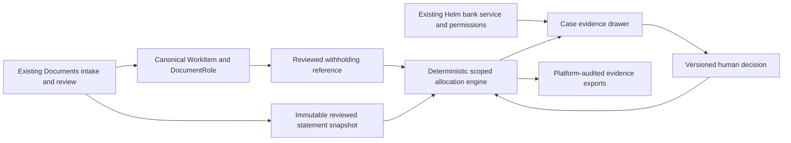

# TRINETRA architecture

Baseline: `bf8f57f691aec7122d9ebaf4a4e13ae9d22ae19c`. Work stays on
`hardening/trinetra`. The original preliminary audit is historical; this document
describes the current implementation (as finished in Final session 2T) and does not imply release approval.
Where the original four-table design is described below and a later section says otherwise, the later section is current.

## Data flow

No new OCR, blob store, financial ledger, tax portal, bank importer, email sender,
payment processor or generic discussion system is introduced. `ledger_store`
provides canonical invoice facts; Helm's identity normalization identifies the
receiving business. Bank evidence passes Helm's existing book and line access
checks. Document links open the existing evidence/review surface. GST contributes
spreadsheet escaping/formatting patterns only, never TDS amounts or eligibility.

## The original four tables (still the core)

`trinetra_profiles`: encrypted PAN and random per-profile identity salt; masked
PAN and keyed identifiers. JWT rotation does not change entity identity.

`trinetra_statements`: canonical source document/version, explicit entity/year,
normalized keyed rows, fingerprint, parser version, revision and active selection.
Content is immutable through the API. A partial unique index admits one active
snapshot per profile/year. Identical reimports return the original snapshot,
including its `active` flag; they do not silently reactivate old evidence.

`trinetra_credits`: canonical invoice reference, reviewed expected amount, source
version fingerprint and review metadata. It does not copy invoice/bank ledger
transactions. Invoice fingerprints cover both WorkItem and DocumentRole versions.

`trinetra_decisions`: append-only API revisions with actor, reason and allocations.
Each decision may record 0–480 self-reported review minutes. Statement comparisons
capture the immediately preceding valid snapshot and unchanged expectation versions.
Only the current decision's allocations affect current figures, and only for the
selected unchanged snapshot. Database administrators remain trusted; no separate
cryptographic certificate or database immutability claim is made.

Every table has organization/workspace scope. Composite foreign keys prevent
profiles, documents and cases being linked across workspaces. Amounts use integer
micros internally and exact decimal strings over JSON. Inputs accept nonnegative
decimal INR with at most two places. Signed corrections require explicit review,
not silent netting. The versioned policy is `trinetra-v1-paise-exact`.

## Transactions and computation

Profile row locks serialize allocation/import/reconfirmation decisions. Each
review carries an expected case revision; stale submissions return 409. Shared
posting and expectation amounts cannot be overallocated. Organization locks
serialize capacity checks across workspaces. Snapshots are deactivated and flushed
before the new active row is inserted. Source erasure cascades dependent views.

Summary reads batch profiles, statements, sources, roles and latest decisions.
They refuse more than 5,000 cases instead of silently truncating exposure. Import
of a typed snapshot is bounded at 500 rows and of an uploaded file at 5,000 rows or 5 MB; decisions at 100 allocations; supporting evidence at 20
documents; histories displayed at 200 events (total disclosed); dossiers at 50,000
events (overflow refused). Single-case lists use bounded offset pagination. The working set is the open cases plus
recently closed ones (at most 5,000; closed cases older than three tax years leave it but stay in the database).

Reviewed receivable confirmation requires current, agreeing advice and accounting
amounts within the supported expectation. Government posting is a separate fact.
`helm_adapter` annotates readable INR payment promises without changing their amounts;
Helm's send-time adapter holds gross reminders until that review is explicitly cleared
or withdrawn. A stale source removes the verified amount but retains the safety hold.
This adapter never writes a settlement. Helm API keys do not gain TRINETRA evidence
through their Helm scope.

Outcome comparison counts current CA-reviewed closure only when the invoice version
and expected amount match the previous import, and caps it by increased statement
amounts for the same scoped deductor. First imports, unchanged reimports, reallocations,
unknown evidence and corrected expectations do not create a measured outcome. Since 2T each
confirmed closure is also written once to the closure ledger (`trinetra_outcomes`, "TDS now visible
in your statement": evidence a credit appears, never cash or a refund). Review time is recorded effort.

## API and worker

Workspace prefix: `/api/v1/workspaces/{workspace_id}/trinetra`.
Routes cover access, sample, profiles, transcription preview/import, explicit
official-format refusal, cases, summary, detail, decisions, reconfirmation,
ownership/evidence review, inquiry draft, CSV/XLSX/HTML export, reconciliation and
run status. Public response contracts live in `services/trinetra/schemas.py`.

Organization summary: `/api/v1/organizations/{organization_id}/trinetra/summary`.
It requires `capability.trinetra_all_workspaces` and applies Helm's readable
workspace set before aggregation. Entities stay separate. `trinetra:read` grants
this single read route; keys cannot import, decide or export cases.

`trinetra.recompute` uses existing job enqueue/idempotency, LIGHT worker registration,
tenant activity/billing gates and explicit handler checks. Shared document-change
hooks debounce requests. The handler reads current evidence; replay has no financial
side effects. No tax/portal network request or AI inference occurs.

## Migration and lifecycle

`tr1a1_credit_assurance` follows `k1a7_pack_check_dismissals` and
`tr1a2_review_outcomes` follows it: one head. The first adds four tables and the
`trinetra:read` key and review-event webhook vocabularies. The second adds comparison,
review-minute and supporting-source fields with backward-compatible defaults.
Downgrading both removes TRINETRA tables, that scope and event subscriptions;
canonical documents, Helm bank evidence
and prices remain. Export before rollback: dropped TRINETRA history is unrecoverable
without a backup. The migration contains static DDL, not imports of future models.

All tables are registered in `services/compliance/data_map.py` and the existing
compliance export. Ciphertext/salt/fingerprint are excluded from profile exports;
keyed deductor identity is excluded from credit exports. Document erasure removes
dependent views. Supporting-source lists use the existing compliance JSON-array link
mechanism for erasure and retention, including copied review history and comparison
baselines. Erasing an input can delete its whole derived comparison snapshot; the
canonical uploaded statement remains subject to its own retention/hold policy.
There is no invented GST statutory-retention exemption for TDS. Both encrypted
profile columns participate in the platform key-rotation sweep.

## Final session 2T: what was added

**Evidence versions.** A case, a snapshot or a comparison baseline is versioned by the content fingerprint of its
documents (`versions.py`, prefix `v2:`), not by `work_items.updated_at`: a rename or a touch is not a change, a replaced
file is. Migration `tr2t1`.

**Identity.** One legal entity, one profile per organization: the PAN is keyed with a random per-organization salt
(`trinetra_org_keys`, `org_pan_fingerprint`, a partial unique index), never decrypted across workspaces. `tr2t2`.

**Modes (`mode.py`, N-201).** `TRINETRA_MODE` is off, pilot (shipping default) or on; one helper `live_for(organization)`
answers every gate (routes, worker, search, notices, Recoveries, Helm adapter's read side). Pilot reads
`trinetra_pilot` (a platform administrator enrols an organization with a reason, audited; `/admin/trinetra/pilot`). The old
`TRINETRA_LIVE_ENABLED` is an alias that wins when set. Helm's reminder hold deliberately ignores the mode. `tr2t3`;
`scripts/preflight.py` reports the mode, the number enrolled and the unverified readers.

**Capacities** count working figures (active snapshots, open cases, profiles), with a retention ceiling as a multiple of the plan's
figure; Business 2 profiles, 12 snapshots, 500 cases, 50 inquiries a month; Enterprise 10, 60, 5,000.

**Statement readers (`readers.py`, `statements/`).** A registry: *rows typed by hand*, the *Servabo template* (CSV/XLSX), an
*AIS TDS CSV* (columns found by heading, confirmed by the person in a mapping preview, TDS rows only), and the *Form 26AS* and
*Form 168 text downloads*. The three official readers are **registered as unverified** (written from secondary sources because the
official TRACES and e-filing hosts could not be reached from the build environment); they refuse differences rather than guess and
the screens label them. Each reader refuses with a row number or heading, never the content. Limits: 5 MB, 5,000 rows. A file-sourced
snapshot has no document in Documents: it is identified by its SHA-256 and `source_meta` (`tr2t4`). No PDF is read.

**Expectations (`suggestions.py`, `directory.py`, `statements/expectations.py`).** Three sources of "the customer withheld tax": a
figure printed on an invoice, the expected-TDS template (Tally users), and a read-only Zoho Books scan (unverified). Each becomes a
*suggestion* that only a person accepts (with a reason, and the seller-name check); the *deductor directory* maps a TAN to a customer
once, reviewed by a person. `trinetra_suggestions`, `trinetra_deductors` (`tr2t5`).

**Money model (`domain.py`, `service.py`; `tr2t6`).** Taxable basis only when sourced; credit notes and reversals as signed rows
paired by a person (`trinetra_pairings`; netting happens only through a pairing); advances; a triggering event; late and duplicate
postings; "closed without resolution" (UNRESOLVED); reject and annotate decisions; a field-level explanation of each match
(which keys agreed, which reader, which rule version).

**Resolution (`inquiries.py`, `approvals.py`, `outcomes.py`; `tr2t7`).** An inquiry to the deductor is a draft a person edits,
approves and sends: only to a contact a person confirmed in Helm, through the existing outbound mail and secure request link,
one per case per week unless a person records a reason, within the plan's monthly allowance, with who approved and sent shown;
a failed mail is a failed inquiry with its link revoked; a reply attaches as evidence to the case it answers and changes nothing
else. Enterprise approval chains: an organization policy (threshold, actions, approver role) makes a closure wait for a different
person in the named role; an approval is tied to the case revision and goes stale if the case moves. The closure ledger and the
measured review time live in `trinetra_outcomes`.

**Integrations (`notices.py`, `events.py`, `hooks.py`; `tr2t8`, `tr2t9`, `tr2t10`).** `trinetra.recompute` now says what is new:
`notices.announce` claims one notice per organization, kind and case revision in `trinetra_notice_sends` (the primary key is the
claim), notifies the owners and administrators who want "TDS credit" notices, and emits `trinetra.case.gap_found` /
`evidence_stale` / `closed` for rules (Business) and webhooks (Enterprise). `trinetra.sweep` (hourly; each notice is claimed once) sends the Monday line, a
30-day "still unresolved" reminder and one bundled notice when more than five arrive together. Getting started, global search (never by PAN or
TAN), the value receipt, Recoveries (kind `TDS_CREDIT`), the warehouse dataset `TRINETRA_CASES` (Enterprise), the organization
view per legal entity (each entity once, even across workspaces) and the public read API (`/cases`) all read the same service; none
writes a case. An inquiry is refused, in words, when the organization's egress policy blocks its mail server, and a legal hold on a document keeps the
invoice and so the case and its history until the hold is released.

**Lifecycle (N-203).** Tax evidence follows one deliberate rule: it is kept while its source documents are kept and erased with
them; a closed case keeps its dossier for the retention period; a confirmed withholding keeps holding Helm's reminders in every
mode. `data_map.py` lists every new table.

**Performance.** The summary indexes a snapshot's postings and allocations once, instead of scanning them per case (F-650):
2.6 s at 5,000 cases, 4.0 s to import a 5,000-row statement over those cases, 1.7 s for the organization view over 100
workspaces (`PERFORMANCE.md`).

**Migrations.** `tr2t1` to `tr2t10`, one head, expand-only except where each docstring says what the downgrade deletes
(file-sourced snapshots in `tr2t4`, pairings and UNRESOLVED closures in `tr2t6`, the four resolution tables in `tr2t7`, the
Recoveries issues of kind TDS_CREDIT in `tr2t10`). Export dossiers before a rollback.
